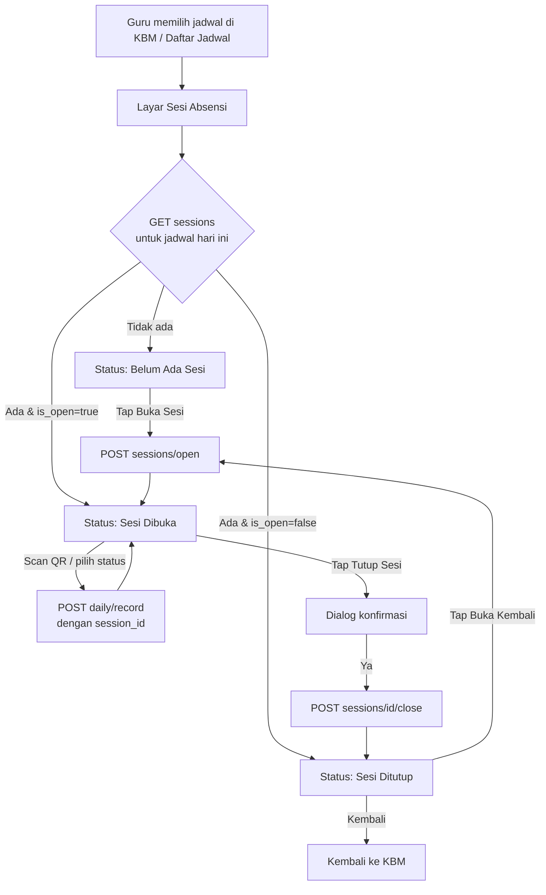
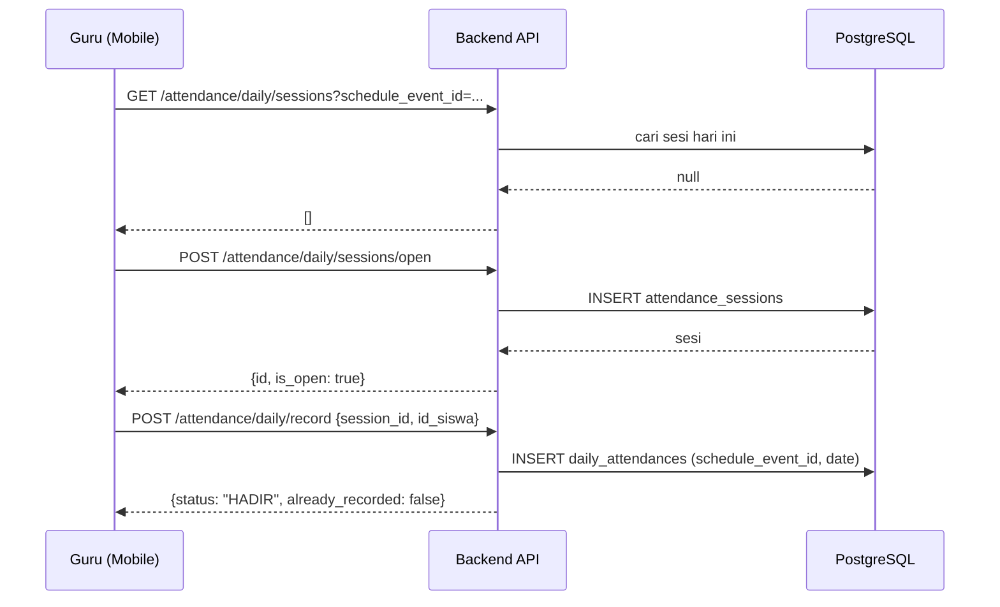

# PRD — Buka & Tutup Sesi Absensi Siswa (Aplikasi Mobile)

| Field | Nilai |
| --- | --- |
| Nama dokumen | PRD Buka & Tutup Sesi Absensi Siswa — Mobile |
| Versi | 1.0 (Draft) |
| Tanggal | 21 November 2026 |
| Status | Draft untuk review |
| Pemilik | Tim Produk Absensi SMPI Bina Cendekia Aqwam |
| Platform | Android & iOS (React Native / Expo) |
| Target rilis | Rilis aplikasi mobile berikutnya |
| Prasyarat backend | Migration `0009_attendance_sessions` (sudah di development; production sesuai §17.1) |
| Dokumen terkait | [Arsitektur & Skema DB](architecture_and_database_schema.md), [Spesifikasi API](fastapi_endpoints_specification.md), [Panduan E2E Frontend](frontend-e2e-testing.md) |

### Status implementasi per 21 November 2026

| Layer | Status |
| --- | --- |
| Database + API sesi absensi | **Selesai** (migration `0009_attendance_sessions`) |
| Halaman web Absensi Harian | **Selesai** |
| Aplikasi mobile | **Belum** — menjadi ruang lingkup PRD ini |

---

## 1. Ringkasan Eksekutif

Guru perlu dapat **membuka sesi absensi** untuk satu jadwal KBM, mencatat kehadiran siswa, lalu **menutup sesi** tersebut. Sesi harus tersimpan di server — bukan hanya di layar aplikasi — sehingga:

1. Sesi tetap ada ketika guru menutup aplikasi, kehilangan sinyal, atau berganti perangkat.
2. Dua guru yang mengajar **rombel yang sama pada hari yang sama** tidak saling melihat atau menimpa data absensi, karena setiap jadwal memiliki sesi sendiri.
3. Riwayat absensi di layar hanya menampilkan catatan dari sesi yang sedang dibuka.

Backend (web dan API) sudah memiliki mekanisme sesi absensi yang persisten. PRD ini mendefinisikan pengembangan fitur yang setara di aplikasi mobile, termasuk perubahan payload pencatatan, state UI, penanganan error, dan rencana rilis.

---

## 2. Latar Belakang & Masalah

### 2.1 Kondisi saat ini

Aplikasi mobile (React Native/Expo) memiliki alur:

- `KbmScreen` → tombol **“Buka Sesi Absensi Siswa”** → `AttendanceSessionScreen`.
- `ScheduleListScreen` → tombol **“Buka Sesi Absensi”** → `AttendanceSessionScreen`.
- `AttendanceSessionScreen` langsung menganggap sesi aktif ketika layar dibuka. Tidak ada panggilan API untuk membuka atau menutup sesi.
- Tombol **“Selesai”** hanya memanggil `navigation.goBack()`; tidak ada status sesi di server.
- Daftar kehadiran dimuat dari `GET /attendance/daily` **tanpa filter sesi dan tanpa filter tanggal**, sehingga menampilkan catatan absensi sekolah dari jadwal/guru lain.
- Pencatatan mengirim `schedule_event_id`, bukan `session_id`.

### 2.2 Akar masalah

Sebelum perubahan backend, tabel `daily_attendances` unik per `(student_id, date)` dan tidak menyimpan jadwal/sesi. Akibatnya:

- Guru B yang membuka jadwal berikutnya untuk rombel yang sama melihat siswa yang sudah ditandai hadir oleh Guru A.
- Siswa yang sama tidak bisa dicatat pada dua jadwal berbeda di hari yang sama.
- Buka/tutup sesi hanya ilusi di sisi klien dan hilang saat aplikasi ditutup.

Backend kini sudah menyimpan sesi per `(schedule_event_id, session_date)` dan setiap record absensi memiliki `schedule_event_id`. Endpoint `POST /attendance/daily/record` **mewajibkan `session_id`**.

### 2.3 Dampak bila mobile tidak diperbarui

- Pencatatan dari versi mobile lama akan ditolak server (validasi `session_id` wajib).
- Bila server diberi fallback `schedule_event_id`, bug kebocoran data antar-guru akan muncul kembali.
- Guru tidak memiliki cara eksplisit untuk menutup sesi dan melihat rekap sesi tersebut.

### 2.4 Tujuan perubahan

Membawa perilaku web yang sudah diperbaiki ke mobile, dengan pengalaman yang lebih ringkas untuk guru yang mengajar di kelas.

---

## 3. Tujuan & Non-Tujuan

### 3.1 Tujuan

| ID | Tujuan | Ukuran keberhasilan |
| --- | --- | --- |
| G-01 | Sesi absensi dibuka dan ditutup secara eksplisit dari mobile | 100% pencatatan mobile memakai `session_id` |
| G-02 | Sesi tetap ada setelah app ditutup/dibuka kembali | Sesi aktif berhasil dipulihkan tanpa membuat sesi baru |
| G-03 | Tidak ada data lintas jadwal/guru pada satu rombel dan hari | 0 insiden data tercampur antar sesi |
| G-04 | Guru dapat menutup sesi dengan aman dan melihat rekap | Sesi tertutup tidak bisa diubah tanpa dibuka kembali |
| G-05 | Error dan status sesi jelas bagi guru | Penurunan error pencatatan yang tidak terjelaskan |

### 3.2 Non-tujuan (fase ini)

- Absensi ujian (EXAM) — tetap memakai alur `EventAttendance` yang sudah ada.
- Absensi datang/pulang guru (`TeacherAttendance`).
- Mode offline penuh dengan antrean sinkronisasi otomatis.
- Perubahan pada laporan dan dashboard admin (sudah ditangani di web/backend).
- Penutupan sesi otomatis berdasarkan jam akhir jadwal.
- Notifikasi push pengingat menutup sesi.

---

## 4. Pengguna & Persona

| Persona | Kebutuhan utama | Hak akses |
| --- | --- | --- |
| **Guru pengampu** | Membuka sesi untuk jadwalnya, scan QR/NISN, menutup sesi, melihat rekap | Hanya jadwal yang `teacher_id`-nya miliknya |
| **Admin** | Membantu/menggantikan guru saat pertukaran jadwal, memantau sesi | Semua jadwal (melalui web; mobile admin tidak menjadi target utama) |

Asumsi: satu akun guru dapat memiliki lebih dari satu jadwal pada hari yang sama, termasuk jadwal dengan rombel yang sama.

---

## 5. Ruang Lingkup

### 5.1 In scope

1. Layar sesi absensi (`AttendanceSessionScreen`) dengan status **Belum ada sesi**, **Dibuka**, dan **Ditutup**.
2. Aksi buka sesi, pulihkan sesi, catat kehadiran, tutup sesi, dan buka kembali sesi.
3. Integrasi API sesi dan pencatatan berbasis `session_id`.
4. Riwayat/rekap hanya untuk sesi yang sedang dipilih.
5. Penanganan error, loading, refresh, dan konfirmasi.
6. Analytics dan pengujian.

### 5.2 Out of scope

- Perubahan skema database (sudah selesai di backend).
- Perubahan halaman web `attendance.tsx`.
- Auto-close sesi.
- Sinkronisasi offline antrean.
- Multi-akun dalam satu perangkat.

---

## 6. Definisi & Istilah

| Istilah | Definisi |
| --- | --- |
| **Jadwal KBM** | `ScheduleEvent` bertipe `KBM` pada tahun ajaran aktif. |
| **Sesi absensi** | Konteks pencatatan untuk satu jadwal KBM pada satu tanggal, disimpan di tabel `attendance_sessions`. |
| **Buka sesi** | Membuat sesi (atau membuka kembali sesi tertutup) untuk jadwal hari ini. |
| **Tutup sesi** | Menandai sesi selesai (`closed_at` terisi); pencatatan baru ditolak sampai sesi dibuka kembali. |
| **Record absensi** | Satu baris `daily_attendances` milik seorang siswa pada satu sesi. |
| **`session_date`** | Tanggal sesi menurut server (Asia/Makassar), bukan jam perangkat. |
| **Rombel** | Kelompok belajar; satu jadwal dapat mencakup beberapa rombel (`rombel_ids`). |

---

## 7. Alur Pengguna

### 7.1 Alur utama — membuka dan menutup sesi



### 7.2 Alur memulihkan sesi

1. Guru masuk ke layar sesi.
2. Aplikasi memanggil `GET /api/v1/attendance/daily/sessions?schedule_event_id=<id>` (tanpa tanggal → server memakai hari ini).
3. Bila sesi ditemukan dan `is_open = true`, layar langsung menampilkan status **Sesi Dibuka**, catatan sesi, dan scanner/list siap dipakai.
4. Bila `is_open = false`, layar menampilkan status **Sesi Ditutup** dan tombol **Buka Kembali Sesi**.
5. Bila tidak ada sesi, layar menampilkan status **Belum Ada Sesi** dengan tombol utama **Buka Sesi Absensi**.

### 7.3 Alur menutup sesi

1. Guru menekan **Tutup Sesi** pada header.
2. Tampil dialog berisi ringkasan: total siswa, hadir, terlambat, izin/sakit/alpa, belum tercatat.
3. Guru memilih **Batal** atau **Tutup Sesi**.
4. Bila dikonfirmasi, aplikasi memanggil `POST /api/v1/attendance/daily/sessions/{session_id}/close`.
5. Layar beralih ke mode read-only: scanner dan tombol ubah status dinonaktifkan.
6. Guru dapat memilih **Buka Kembali Sesi** (jika perlu koreksi) atau **Kembali ke KBM**.

> Sesi tidak menutup otomatis saat guru menekan tombol back. Menekan back hanya meninggalkan layar; sesi tetap terbuka di server sampai ditutup secara eksplisit.

### 7.4 Alur saat sesi sudah ditutup di perangkat lain

1. Guru A menutup sesi dari perangkat lain.
2. Guru A atau admin membuka layar yang sama di perangkat ini.
3. Saat refresh/load, status sesi menjadi **Ditutup**; aplikasi menonaktifkan scanner.
4. Bila percobaan pencatatan tetap terjadi, server mengembalikan `422 Sesi absensi sudah ditutup`; aplikasi menampilkan dialog dan memuat ulang status sesi.

---

## 8. Kebutuhan Fungsional

Prioritas: **M** = Must, **S** = Should, **C** = Could.

| ID | Prioritas | Kebutuhan |
| --- | --- | --- |
| FR-01 | M | Layar sesi menerima `scheduleId`, judul jadwal, dan nama rombel dari `KbmScreen` maupun `ScheduleListScreen`. |
| FR-02 | M | Saat layar dibuka, aplikasi memuat sesi hari ini untuk jadwal tersebut dari server. |
| FR-03 | M | Jika belum ada sesi, tampil status kosong dengan penjelasan dan satu CTA utama **Buka Sesi Absensi**. |
| FR-04 | M | **Buka Sesi** memanggil API dan menyimpan sesi di server; tombol tidak boleh mengirim permintaan ganda (debounce/disabled). |
| FR-05 | M | Jika sesi sudah ada dan terbuka, layar langsung siap mencatat tanpa membuat sesi baru. |
| FR-06 | M | Jika sesi tertutup, layar menampilkan status tertutup, rekap read-only, dan CTA **Buka Kembali Sesi**. |
| FR-07 | M | Header menampilkan status sesi, judul jadwal, rombel, dan jam buka sesi (format lokal). |
| FR-08 | M | Semua pencatatan mengirim `session_id` dari sesi aktif; `schedule_event_id` hanya dipakai untuk mencari sesi. |
| FR-09 | M | Pencatatan mendukung QR UUID siswa, NISN manual, dan pemilihan status manual (Hadir/Terlambat/Izin/Sakit/Alpa). |
| FR-10 | M | Scan ganda dalam sesi yang sama menampilkan pesan “sudah tercatat pada sesi ini” dan tidak menggandakan record. |
| FR-11 | M | **Tutup Sesi** menampilkan konfirmasi dengan ringkasan sebelum memanggil API. |
| FR-12 | M | Setelah ditutup, scanner dan aksi ubah status dinonaktifkan sampai sesi dibuka kembali. |
| FR-13 | M | **Buka Kembali Sesi** memanggil endpoint open yang sama; sesi dan record lama harus tetap ada (idempotent). |
| FR-14 | M | Daftar siswa dan riwayat hanya menampilkan data milik sesi aktif. |
| FR-15 | M | Tarik-untuk-refresh (pull-to-refresh) memuat ulang status sesi dan rekap; status sesi juga dimuat ulang saat aplikasi kembali aktif (AppState `active`). |
| FR-16 | M | Error 403/404/422/network dipetakan ke pesan yang dapat ditindaklanjuti (lihat §11.3). |
| FR-17 | S | Sesi yang dibuka/ditutup di perangkat lain tercermin setelah refresh; tidak perlu real-time push. |
| FR-18 | S | Jika jadwal sudah tidak aktif (mis. dihapus/diubah), layar menampilkan pesan dan menonaktifkan aksi buka sesi. |
| FR-19 | S | Ringkasan sesi (hadir, terlambat, izin/sakit/alpa, belum) dihitung dari record sesi. |
| FR-20 | S | Haptic feedback sukses/gagal tetap dipertahankan setelah pencatatan. |
| FR-21 | S | Jika aplikasi ditutup saat sesi terbuka, sesi tetap terbuka di server dan dipulihkan saat dibuka kembali. |
| FR-22 | C | Indikator “dibuka oleh” pada sesi yang dibuka admin/guru lain (field `opened_by_name`). |
| FR-23 | C | Peringatan sebelum menutup sesi bila masih ada siswa belum tercatat. |
| FR-24 | C | Tombol “Tutup Sesi” juga tersedia dari ringkasan bawah setelah semua siswa selesai. |

---

## 9. Kebutuhan UX / UI

### 9.1 Titik masuk

| Layar | Perubahan |
| --- | --- |
| `KbmScreen` | Tombol **Buka Sesi Absensi Siswa** membawa `scheduleId`, `scheduleTitle`, `rombelName`, dan `rombelIds`. |
| `ScheduleListScreen` | Tombol **Buka Sesi Absensi** membawa data yang sama. Perbaiki bug lama yang mengirim `rombelName: item.title`. |
| `AttendanceSessionScreen` | Menjadi layar state machine sesi (buka/tutup), bukan langsung menganggap sesi aktif. |

### 9.2 State layar

#### A. Loading

- Skeleton/`ActivityIndicator` di area konten.
- Header tetap menampilkan judul jadwal.
- Tombol aksi disembunyikan sampai status sesi diketahui.

#### B. Belum ada sesi

- Badge abu-abu: **BELUM ADA SESI**.
- Teks: “Sesi absensi untuk jadwal ini belum dibuka. Buka sesi untuk mulai mencatat kehadiran.”
- CTA utama: **Buka Sesi Absensi**.
- Scanner dan daftar siswa disembunyikan atau dinonaktifkan.

#### C. Sesi dibuka

- Badge hijau: **SESI DIBUKA**.
- Subteks: “Dibuka pukul HH:mm” (dan “oleh <nama>” bila tersedia).
- Scanner QR, tab daftar siswa, pencarian, dan aksi status aktif.
- Ringkasan counter (total, hadir, terlambat, izin/sakit/alpa, belum).
- Tombol header: **Tutup Sesi**.

#### D. Sesi ditutup

- Badge amber/abu: **SESI DITUTUP**.
- Subteks: “Ditutup pukul HH:mm”.
- Data siswa dan rekap tetap terlihat (read-only).
- Scanner, input NISN, dan tombol ubah status dinonaktifkan.
- CTA utama: **Buka Kembali Sesi**.
- CTA sekunder: **Kembali ke KBM**.

#### E. Error

- Error muat sesi: tampil panel error + tombol **Coba Lagi**; jangan tampilkan scanner.
- Error buka/tutup sesi: dialog/alert dengan pesan dari server + aksi coba lagi.
- Error pencatatan: banner di kamera dan/atau alert daftar, dengan pesan yang dipetakan.

### 9.3 Copywriting utama

| Konteks | Teks |
| --- | --- |
| Tombol buka | “Buka Sesi Absensi” |
| Konfirmasi buka | “Buka sesi absensi untuk <judul jadwal>? Kehadiran akan dicatat pada sesi ini.” |
| Sukses buka | “Sesi absensi dibuka dan tersimpan.” |
| Konfirmasi tutup | “Tutup sesi absensi? Setelah ditutup, kehadiran tidak dapat dicatat sampai sesi dibuka kembali.” |
| Sukses tutup | “Sesi absensi ditutup.” |
| Sesi tertutup | “Sesi absensi sudah ditutup. Buka kembali sesi untuk melanjutkan pencatatan.” |
| Duplikat | “<Nama> sudah tercatat pada sesi ini.” |
| Di luar jadwal | “Jadwal ini tidak aktif untuk hari ini.” |
| Bukan jadwal guru | “Jadwal ini bukan jadwal mengajar Anda.” |
| Sesi tidak ditemukan | “Sesi absensi tidak ditemukan. Muat ulang halaman.” |
| Jaringan | “Tidak dapat terhubung ke server. Periksa koneksi lalu coba lagi.” |

### 9.4 Panduan visual & aksesibilitas

- Target sentuh minimal **44×44 px** (termasuk tombol tutup, tab, dan CTA).
- Kontras teks memenuhi WCAG AA; status memakai teks, bukan hanya warna.
- Status sesi diumumkan ke pembaca layar (`accessibilityLiveRegion="polite"`).
- Tombol dinonaktifkan memakai opasitas dan `accessibilityState={{ disabled: true }}`.
- Konfirmasi tutup sesi menggunakan dialog native (`Alert.alert`) dengan tombol destruktif yang jelas.
- Format jam menggunakan Asia/Makassar (server), bukan zona waktu perangkat.

### 9.5 Wireframe ringkas

```
┌─────────────────────────────────────┐
│ ←  SESI DIBUKA           [Tutup Sesi]│
│    Matematika — Kelas 7A            │
│    Dibuka 08:12 oleh Guru A         │
├─────────────────────────────────────┤
│ Total 32  Hadir 28  Telat 2  Belum 2│
├─────────────────────────────────────┤
│ [ Scanner QR ] [ Daftar Siswa (32) ]│
│                                     │
│   (kamera / daftar siswa)           │
│                                     │
└─────────────────────────────────────┘
```

---

## 10. Aturan Bisnis & Otorisasi

| ID | Aturan |
| --- | --- |
| BR-01 | Satu sesi per kombinasi `schedule_event_id` + `session_date`; unik di database. |
| BR-02 | Sesi hanya untuk KBM pada tahun ajaran aktif dan **hari ini** menurut server (Asia/Makassar). |
| BR-03 | Guru hanya dapat membuka/menutup/mencatat pada jadwal miliknya; admin dapat melakukan untuk semua jadwal. |
| BR-04 | Pencatatan hanya diizinkan pada sesi yang **terbuka** dan bertanggal hari ini. |
| BR-05 | Sesi tertutup bersifat read-only bagi guru; hanya dapat diubah setelah dibuka kembali. |
| BR-06 | Membuka kembali sesi memakai `id` yang sama dan tidak menghapus record lama. |
| BR-07 | Satu siswa hanya memiliki satu record per sesi; scan ulang mengembalikan `already_recorded`. |
| BR-08 | Dua jadwal berbeda pada rombel dan tanggal yang sama memiliki sesi dan record yang independen. |
| BR-09 | Sesi tidak menutup otomatis; penutupan harus eksplisit. |
| BR-10 | Status `HADIR`/`TERLAMBAT` dihitung server berdasarkan jam mulai jadwal + toleransi 10 menit; klien tidak mengirim jam. |
| BR-11 | Tanggal sesi dan absensi berasal dari server; jam perangkat tidak dipercaya. |
| BR-12 | Siswa harus aktif dan berada pada salah satu rombel jadwal (`rombel_ids`). |

---

## 11. Kontrak API (Sudah Tersedia di Backend)

Base URL mobile: `<server>/api/v1` (lihat `apiClient`). Semua endpoint membutuhkan bearer token.

### 11.1 Endpoint sesi

#### `POST /attendance/daily/sessions/open`

Membuka sesi untuk jadwal hari ini. Idempotent: jika sesi sudah ada, mengembalikan sesi yang sama; jika tertutup, sesi dibuka kembali.

Request:

```json
{
  "schedule_event_id": "6f1c2a7e-8f0d-4f4e-9a6b-1c2d3e4f5a6b"
}
```

Response `200`:

```json
{
  "id": "0b7e8f9a-1c2d-4e5f-8a9b-0c1d2e3f4a5b",
  "schedule_event_id": "6f1c2a7e-8f0d-4f4e-9a6b-1c2d3e4f5a6b",
  "session_date": "2026-11-21",
  "opened_by": "3c4d5e6f-7a8b-4c9d-8e0f-1a2b3c4d5e6f",
  "opened_by_name": "Guru A",
  "opened_at": "2026-11-21T00:12:00Z",
  "closed_by": null,
  "closed_at": null,
  "is_open": true
}
```

Kemungkinan error:

| Status | `detail` | Arti |
| --- | --- | --- |
| 403 | `Jadwal ini bukan jadwal mengajar Anda` | Bukan jadwal guru |
| 422 | `Jadwal tidak aktif untuk hari ini` | Bukan KBM aktif hari ini |

#### `GET /attendance/daily/sessions`

Query: `schedule_event_id` (wajib untuk layar sesi), `attendance_date` (opsional, default hari ini).

Response `200`: array objek sesi seperti di atas. Guru hanya menerima sesi jadwalnya.

#### `POST /attendance/daily/sessions/{session_id}/close`

Menutup sesi. Idempotent.

Response `200`: objek sesi dengan `is_open: false`, `closed_at`, dan `closed_by`.

Kemungkinan error:

| Status | `detail` |
| --- | --- |
| 403 | `Jadwal ini bukan jadwal mengajar Anda` |
| 404 | `Sesi absensi tidak ditemukan` |

### 11.2 Endpoint pencatatan & riwayat

#### `POST /attendance/daily/record`

Request (salah satu identifier siswa):

```json
{
  "session_id": "0b7e8f9a-1c2d-4e5f-8a9b-0c1d2e3f4a5b",
  "id_siswa": "9a8b7c6d-5e4f-3a2b-1c0d-9e8f7a6b5c4d",
  "check_in": true
}
```

Manual status:

```json
{
  "session_id": "0b7e8f9a-1c2d-4e5f-8a9b-0c1d2e3f4a5b",
  "id_siswa": "9a8b7c6d-5e4f-3a2b-1c0d-9e8f7a6b5c4d",
  "check_in": false,
  "status": "IZIN",
  "notes": "Surat dokter"
}
```

Response `200` (ringkas):

```json
{
  "id": "72e5f1a0-...",
  "student_id": "9a8b7c6d-...",
  "student_name": "Siswa A",
  "schedule_event_id": "6f1c2a7e-...",
  "date": "2026-11-21",
  "check_in_time": "2026-11-21T00:20:00Z",
  "check_out_time": null,
  "status": "HADIR",
  "notes": null,
  "already_recorded": false
}
```

Kemungkinan error:

| Status | `detail` | Penanganan mobile |
| --- | --- | --- |
| 403 | `Jadwal ini bukan jadwal mengajar Anda` | Tampilkan pesan; kembali ke daftar jadwal |
| 404 | `Sesi absensi tidak ditemukan` | Muat ulang sesi |
| 404 | `Siswa tidak ditemukan atau tidak aktif` | Banner error, tetap di sesi |
| 422 | `Sesi absensi sudah ditutup` | Muat ulang sesi → mode read-only |
| 422 | `Sesi absensi sudah tidak berlaku` | Muat ulang sesi → status kosong/expired |
| 422 | `Jadwal tidak aktif untuk hari ini` | Nonaktifkan aksi, tampilkan pesan |
| 422 | `Siswa bukan peserta pada rombel jadwal ini` | Banner error |
| 422 | `id_siswa, student_id, atau nisn wajib diisi` | Bug klien; log dan tampilkan error umum |

#### `GET /attendance/daily?session_id={session_id}`

Mengembalikan record milik sesi tersebut. Dipakai untuk mengisi peta status siswa dan panel riwayat sesi. Guru lain yang mencoba mengakses sesi bukan miliknya mendapat `403`.

### 11.3 Pemetaan error ke UI

| Kondisi | Aksi aplikasi |
| --- | --- |
| Tidak ada koneksi / timeout | Tampilkan status offline + tombol **Coba Lagi**; jangan mengubah status sesi lokal |
| 401 | Logout paksa / arahkan ke login (perilaku auth yang sudah ada) |
| 403 | Dialog “Anda tidak berhak…” lalu kembali ke daftar jadwal |
| 404 sesi | Muat ulang daftar sesi; jika tetap kosong tampilkan status Belum Ada Sesi |
| 422 sesi ditutup | Refetch sesi, ubah ke mode read-only, tampilkan info |
| 5xx | Pesan umum + opsi coba lagi; pertahankan state |

### 11.4 Tipe data mobile yang perlu diperbarui

```ts
export type AttendanceSession = {
  id: string;
  schedule_event_id: string;
  session_date: string;
  opened_by?: string | null;
  opened_by_name?: string | null;
  opened_at: string;
  closed_by?: string | null;
  closed_at?: string | null;
  is_open: boolean;
};

export type DailyAttendance = {
  // field lama...
  schedule_event_id?: string | null;
};

export type DailyRecordPayload = {
  session_id: string;
  id_siswa?: string;
  student_id?: string;
  nisn?: string;
  status?: AttendanceStatus;
  check_in?: boolean;
  notes?: string;
};
```

Method API yang perlu ditambahkan/diubah:

- `getDailySessions(scheduleEventId: string): Promise<AttendanceSession[]>`
- `openDailySession(scheduleEventId: string): Promise<AttendanceSession>`
- `closeDailySession(sessionId: string): Promise<AttendanceSession>`
- `getDailyAttendanceLogs(params: { sessionId: string }): Promise<DailyAttendance[]>`
- `recordAttendance(payload: DailyRecordPayload)` — mengganti `schedule_event_id` menjadi `session_id`.

---

## 12. Perubahan Model Data (Referensi Backend)

Implementasi backend yang menjadi dasar PRD ini:

- Tabel `attendance_sessions`: `id`, `schedule_event_id`, `session_date`, `opened_by`, `opened_at`, `closed_by`, `closed_at`; unik pada `(schedule_event_id, session_date)`.
- Tabel `daily_attendances`: kolom baru `schedule_event_id` (nullable hanya untuk data legacy), constraint unik `(student_id, schedule_event_id, date)`.
- Migration: [0009_attendance_sessions.py](../apps/backend/alembic/versions/0009_attendance_sessions.py).
- API: [attendance.py](../apps/backend/app/api/attendance.py).
- Regression test: [test_attendance_sessions.py](../apps/backend/tests/test_attendance_sessions.py).

Catatan kompatibilitas data lama: record sebelum perubahan memiliki `schedule_event_id = NULL`, tetap muncul di laporan harian, dan tidak termasuk dalam sesi baru.

---

## 13. Kasus Tepi & Penanganan

| ID | Skenario | Perilaku yang diharapkan |
| --- | --- | --- |
| EC-01 | Guru menekan **Buka Sesi** dua kali cepat | Tombol disabled saat request berjalan; server idempotent; hanya satu sesi |
| EC-02 | Dua perangkat membuka sesi bersamaan | Keduanya mendapat sesi yang sama (unique constraint + fallback server) |
| EC-03 | Guru menutup sesi saat scan sedang diproses | Request scan bisa sukses/gagal; setelah selesai, refetch sesi dan tampilkan status tertutup |
| EC-04 | App ditutup saat sesi terbuka | Sesi tetap terbuka di server; dibuka kembali → status Dipulihkan |
| EC-05 | App dibuka keesokan harinya | Tidak ada sesi untuk hari ini → status Belum Ada Sesi; sesi kemarin tidak ditampilkan |
| EC-06 | Jam perangkat salah | Tidak berpengaruh; tanggal/jam dari server |
| EC-07 | Sesi dibuka 23:59 dan scan 00:01 | Sesi dianggap tidak berlaku; server menolak; aplikasi memuat ulang |
| EC-08 | Guru mengajar dua jadwal di rombel sama | Sesi terpisah; record jadwal pertama tidak muncul di jadwal kedua |
| EC-09 | Jadwal dihapus/diubah admin saat sesi berjalan | Refetch gagal/422; tampilkan pesan dan nonaktifkan aksi |
| EC-10 | Siswa pindah rombel setelah sesi dibuka | Server menolak jika bukan peserta; tampil banner error |
| EC-11 | Scan siswa yang sama dua kali | `already_recorded: true`; pesan “sudah tercatat pada sesi ini” |
| EC-12 | Sesi ditutup di perangkat lain | Setelah refresh/AppState aktif, status berubah jadi tertutup |
| EC-13 | Admin membuka sesi untuk jadwal guru | Guru melihat sesi terbuka dan dapat melanjutkan; `opened_by_name` ditampilkan (opsional) |
| EC-14 | Sesi lama tertutup lalu dibuka kembali | `session_id` sama; seluruh record lama tetap ada |
| EC-15 | Tidak ada siswa di rombel | Tetap bisa buka/tutup sesi; tampil empty state daftar siswa |
| EC-16 | Koneksi terputus saat buka sesi | Tampil error, status tetap Belum Ada Sesi; tombol coba lagi |
| EC-17 | Token kedaluwarsa | Alur auth yang ada (401) menangani login ulang |

---

## 14. Kebutuhan Non-Fungsional

| Kategori | Target |
| --- | --- |
| Performa | Muat status sesi P95 < 1,5 detik pada jaringan sekolah; pencatatan P95 < 1 detik |
| Keandalan | Tidak ada duplikasi sesi/record; retry aman (idempotent) |
| Keamanan | Bearer token; `session_id` tidak boleh di-log dalam bentuk yang dapat disalahgunakan; akses sesi divalidasi server |
| Privasi | Data siswa hanya ditampilkan untuk jadwal/sesi yang berhak |
| Aksesibilitas | Target sentuh ≥ 44 px, label pembaca layar, kontras AA |
| Lokalisasi | Bahasa Indonesia; zona waktu Asia/Makassar |
| Kompatibilitas | Android 8+ dan iOS versi yang didukung Expo SDK proyek |
| Observabilitas | Event analytics + log error tanpa data pribadi berlebih |
| Crash-free | ≥ 99,5% sesi aplikasi |

---

## 15. Analytics & Metrik Keberhasilan

### 15.1 Event

| Event | Properti | Tujuan |
| --- | --- | --- |
| `attendance_session_viewed` | `schedule_id`, `state` | Mengukur kunjungan dan state awal |
| `attendance_session_opened` | `schedule_id`, `session_id`, `reopened` | Adopsi fitur |
| `attendance_session_open_failed` | `schedule_id`, `reason` | Deteksi kegagalan |
| `attendance_record_submitted` | `session_id`, `method` (`qr`/`manual`), `status` | Volume pencatatan |
| `attendance_record_succeeded` | `session_id`, `already_recorded`, `status` | Keberhasilan |
| `attendance_record_failed` | `session_id`, `reason` | Diagnosis error |
| `attendance_session_closed` | `session_id`, `duration_minutes`, `recorded_count` | Penyelesaian sesi |
| `attendance_session_reopened` | `session_id` | Koreksi pascatutup |

### 15.2 KPI

| KPI | Target awal |
| --- | --- |
| Sesi dibuka dari mobile per hari sekolah | ≥ 90% jadwal yang dimulai |
| Sesi ditutup pada hari yang sama | ≥ 85% |
| Pencatatan gagal karena “sesi ditutup” | < 2% |
| Insiden data lintas jadwal | 0 |
| Waktu median buka → tutup | Mendekati durasi jam pelajaran |
| Crash-free users | ≥ 99,5% |

---

## 16. Rencana Pengujian & Acceptance Criteria

### 16.1 Acceptance criteria (contoh Gherkin)

**AC-01 — Buka sesi pertama kali**

```gherkin
Given guru membuka jadwal KBM hari ini yang belum memiliki sesi
When guru menekan "Buka Sesi Absensi" dan mengonfirmasi
Then aplikasi memanggil POST /attendance/daily/sessions/open
And layar menampilkan status "SESI DIBUKA"
And sesi tersimpan di server
```

**AC-02 — Sesi dipulihkan**

```gherkin
Given sesi untuk jadwal tersebut sudah terbuka di server
When guru menutup lalu membuka kembali aplikasi dan masuk ke jadwal yang sama
Then layar langsung menampilkan status "SESI DIBUKA" tanpa membuat sesi baru
And riwayat sesi menampilkan record yang sudah ada
```

**AC-03 — Pencatatan memakai sesi**

```gherkin
Given sesi sedang terbuka
When guru memindai QR siswa
Then payload berisi session_id sesi aktif
And status siswa tampil di daftar
```

**AC-04 — Isolasi antar jadwal**

```gherkin
Given Guru A mencatat Siswa X pada jadwal pagi di rombel 7A
When Guru B membuka jadwal siang di rombel 7A pada hari yang sama
Then daftar siswa tidak menampilkan catatan Guru A
And Guru B dapat mencatat Siswa X pada sesinya sendiri
```

**AC-05 — Tutup sesi**

```gherkin
Given sesi terbuka
When guru menekan "Tutup Sesi" dan mengonfirmasi
Then aplikasi memanggil POST /attendance/daily/sessions/{id}/close
And scanner dan aksi ubah status dinonaktifkan
And status berubah menjadi "SESI DITUTUP"
```

**AC-06 — Tolak pencatatan pada sesi tertutup**

```gherkin
Given sesi sudah ditutup
When aplikasi mencoba mencatat kehadiran
Then server mengembalikan 422 "Sesi absensi sudah ditutup"
And aplikasi memuat ulang sesi dan menampilkan mode read-only
```

**AC-07 — Buka kembali sesi**

```gherkin
Given sesi tertutup memiliki 20 record
When guru menekan "Buka Kembali Sesi"
Then sesi yang sama dibuka (id tidak berubah)
And seluruh 20 record tetap tersedia
```

### 16.2 Matriks pengujian

| Level | Cakupan |
| --- | --- |
| Unit test | Reducer/state sesi, debounce tombol, pemetaan error, payload API |
| Integration test | Mock server untuk open/close/record/refetch; restore AppState |
| Contract test | Payload `session_id`, respons `is_open`, error 403/422 |
| E2E mobile (jika framework tersedia) | Alur buka → catat → tutup → buka kembali |
| Manual QA | Android & iOS, jaringan lambat, kamera, rotasi, dark mode (jika ada) |
| Backend regression | `pytest tests/test_attendance_sessions.py` dan suite backend |
| Web regression | E2E web yang sudah ada (`workflows.spec.ts` — isolasi sesi) |

### 16.3 Definition of Done

- [ ] Semua FR prioritas **M** terimplementasi.
- [ ] Tidak ada payload mobile yang masih mengirim `schedule_event_id` ke endpoint record.
- [ ] Sesi dipulihkan setelah app kill dan AppState aktif.
- [ ] Tutup sesi meminta konfirmasi dan mengubah UI menjadi read-only.
- [ ] Error 403/404/422/network memiliki pesan yang benar.
- [ ] Unit/integration test lulus.
- [ ] Manual QA pada minimal satu perangkat Android dan satu iOS.
- [ ] Analytics event terpasang dan terverifikasi.
- [ ] Dokumentasi API mobile diperbarui.

---

## 17. Rencana Rilis & Kompatibilitas

### 17.1 Prasyarat

1. Migration `0009_attendance_sessions` sudah dijalankan di setiap environment (dev/staging/production).
2. Backend web/API versi sesi sudah aktif.
3. Aplikasi mobile baru sudah lolos QA.

### 17.2 Kompatibilitas versi lama

- Versi mobile lama mengirim `schedule_event_id` tanpa `session_id`.
- Server baru menolak payload tersebut dengan `422`. **Jangan** menambahkan fallback yang membuat sesi otomatis, karena akan mengembalikan bug kebocoran data.
- Rekomendasi:
  - Tetapkan **minimum supported app version** dan tampilkan paksa update.
  - Jika mekanisme force update belum ada, rilis mobile baru lebih dulu, pantau adopsi, lalu aktifkan backend di production.
  - Sampaikan ke guru bahwa aplikasi harus diperbarui.

### 17.3 Rollout

| Tahap | Aksi |
| --- | --- |
| Internal | QA + guru pilot (1–2 kelas) |
| 10% | Rilis bertahap, pantau `attendance_record_failed` dan `attendance_session_open_failed` |
| 50% | Perluas bila error < 2% dan tidak ada insiden data tercampur |
| 100% | Rilis penuh; umumkan panduan singkat |

### 17.4 Rollback

- Skema database bersifat aditif; rollback aplikasi mobile tidak menghapus data sesi.
- Bila ada bug kritis, hentikan rollout dan rilis patch; hindari downgrade backend setelah ada record sesi baru.
- Sesi yang terlanjur terbuka tetap dapat ditutup melalui web/admin.

---

## 18. Risiko & Mitigasi

| Risiko | Dampak | Mitigasi |
| --- | --- | --- |
| Versi mobile lama masih beredar | Pencatatan gagal | Force update / rilis mobile sebelum backend production |
| Guru lupa menutup sesi | Sesi tetap terbuka | Indikator status jelas; pertimbangkan pengingat/auto-close di fase berikutnya |
| Guru tidak sengaja menutup sesi | Pencatatan terhenti | Dialog konfirmasi + fitur buka kembali |
| Jaringan sekolah tidak stabil | Gagal catat | Retry aman, pesan jelas, sesi persisten |
| Perbedaan jam perangkat | Tanggal salah | Server authoritative; tampilkan tanggal server |
| Sesi dibuka admin dengan akun berbeda | Kebingungan | Tampilkan `opened_by_name` (opsional) |
| Dua jadwal rombel sama | Guru bingung data “hilang” | Jelaskan di UI bahwa data terikat sesi/jadwal; tampilkan judul sesi |
| Sesi tertutup di perangkat lain | Scan ditolak | Refetch saat AppState aktif + penanganan 422 |

---

## 19. Pertanyaan Terbuka

1. Apakah sesi perlu **ditutup otomatis** pada jam akhir jadwal, atau tetap manual?
2. Apakah guru boleh membuka kembali sesi yang sudah ditutup pada hari yang sama tanpa batas?
3. Apakah tombol tutup harus memblokir bila masih ada siswa “belum tercatat”, atau hanya menampilkan peringatan?
4. Apakah admin dapat menutup/membuka sesi dari mobile, atau hanya dari web?
5. Apakah perlu antrean offline (simpan scan lokal lalu sinkron) di fase berikutnya?
6. Berapa versi minimum aplikasi yang didukung dan apakah mekanisme force update sudah tersedia?
7. Apakah `opened_by_name` perlu ditampilkan ke guru, atau cukup untuk admin?

---

## 20. Lampiran

### 20.1 Contoh sequence — buka sesi & catat



### 20.2 Checklist QA manual

- [ ] Buka sesi dari KBM dan dari Daftar Jadwal.
- [ ] Tutup aplikasi, buka lagi, sesi tetap terbuka.
- [ ] Dua guru, rombel sama, hari sama, jadwal berbeda — data terpisah.
- [ ] Tekan buka/tutup dua kali cepat.
- [ ] Scan QR, NISN, dan pilih status manual.
- [ ] Scan siswa yang sama dua kali.
- [ ] Tutup sesi, coba scan lagi → ditolak dengan pesan jelas.
- [ ] Buka kembali sesi → data lama tetap ada.
- [ ] Mode pesawat → pesan error, tidak ada data lokal yang salah.
- [ ] Ganti akun guru → tidak melihat sesi guru lain.
- [ ] Target sentuh dan pembaca layar.

### 20.3 Referensi implementasi

- Backend endpoint: [`apps/backend/app/api/attendance.py`](../apps/backend/app/api/attendance.py)
- Model & constraint: [`apps/backend/app/models.py`](../apps/backend/app/models.py)
- Migration: [`apps/backend/alembic/versions/0009_attendance_sessions.py`](../apps/backend/alembic/versions/0009_attendance_sessions.py)
- Regression test sesi: [`apps/backend/tests/test_attendance_sessions.py`](../apps/backend/tests/test_attendance_sessions.py)
- Web parity (acuan UX): [`apps/frontend/src/pages/attendance.tsx`](../apps/frontend/src/pages/attendance.tsx)
- E2E web isolasi sesi: [`apps/frontend/e2e/workflows.spec.ts`](../apps/frontend/e2e/workflows.spec.ts)

---

**Catatan versi:** PRD ini berfokus pada perubahan yang sudah tersedia di backend per 21 November 2026. Setiap perubahan kontrak API setelah tanggal tersebut harus memperbarui §11 dan dokumen [Spesifikasi API](fastapi_endpoints_specification.md).
